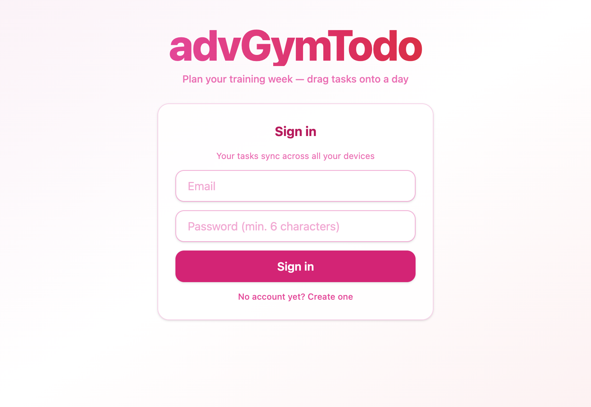
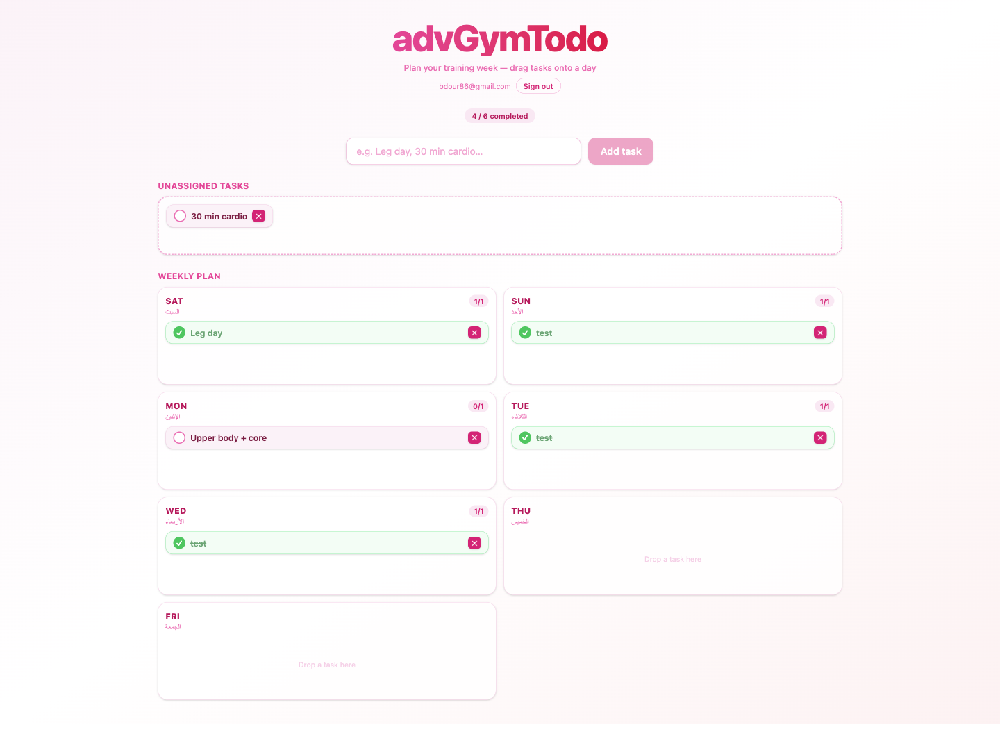

# advGymTodo

A simple weekly planner for gym workouts. Add your training tasks, drag each one onto a day of the week, and tick them off as you go. Tasks are saved to your account, so they sync across all your devices.

**Live app:** https://buduro.github.io/advGymTodo/

## Screenshots

### Sign in



### Weekly board



## Features

- Add tasks and keep them in an "Unassigned" pool until you decide on a day
- Drag and drop tasks onto any day of the week (Saturday to Friday)
- Mark tasks as completed and see a per-day progress count
- Delete tasks you no longer need
- Email and password accounts; each user only sees their own tasks
- Works on desktop and mobile

## Tech stack

- [React 19](https://react.dev) + [TypeScript](https://www.typescriptlang.org)
- [Vite](https://vite.dev) for development and builds
- [Tailwind CSS v4](https://tailwindcss.com) for styling
- [dnd-kit](https://dndkit.com) for drag and drop
- [Supabase](https://supabase.com) for authentication and the database
- GitHub Actions + GitHub Pages for deployment

## Project structure

```
src/
  app/            App shell and page layout
  features/
    auth/         Sign in / sign up (api, components, hooks)
    todos/        Tasks, weekly board, drag and drop (api, components, hooks, utils)
  components/     Shared UI pieces (e.g. drag-and-drop wrappers)
  lib/            Shared clients (Supabase)
```

Each feature owns its own API calls, components, and hooks. Shared code lives in `components/` and `lib/`, and is imported with the `@/` alias.

## Running locally

Requirements: Node 22+ and [pnpm](https://pnpm.io).

```bash
pnpm install
pnpm dev
```

Then open http://localhost:5173/advGymTodo/

Other scripts:

```bash
pnpm build     # type-check and build for production
pnpm lint      # run ESLint
pnpm preview   # preview the production build
```

## Supabase setup

The app expects a `todos` table protected by Row Level Security, so users can only read and write their own rows.

```sql
create table public.todos (
  id uuid primary key,
  user_id uuid not null references auth.users (id) on delete cascade,
  title text not null,
  day text check (day in ('sat', 'sun', 'mon', 'tue', 'wed', 'thu', 'fri')),
  is_completed boolean not null default false,
  created_at timestamptz not null default now()
);

alter table public.todos enable row level security;

create policy "Users can read their own todos"
  on public.todos for select using (auth.uid() = user_id);

create policy "Users can insert their own todos"
  on public.todos for insert with check (auth.uid() = user_id);

create policy "Users can update their own todos"
  on public.todos for update using (auth.uid() = user_id);

create policy "Users can delete their own todos"
  on public.todos for delete using (auth.uid() = user_id);
```

The project URL and publishable key live in `src/lib/supabase.ts`.

## Deployment

Every push to `main` runs `.github/workflows/deploy.yml`, which builds the app and publishes it to GitHub Pages.
